# LeadNest

LeadNest is an AI-powered CRM for small businesses. The platform is a
monorepo: a Go API and a React web client, each in its own directory, wired
together with Docker Compose.

| Directory   | Contents                                              |
| ----------- | ----------------------------------------------------- |
| `backend/`  | Go API, SQL migrations, scripts and integration tests |
| `frontend/` | React + TypeScript web client                         |

- **Backend documentation** → [`backend/README.md`](backend/README.md)
- **Frontend documentation** → [`frontend/README.md`](frontend/README.md)

---

## Screens

Every image below is rendered by Chromium against the running stack, and every
row of data was written through the real API — nothing is mocked. Regenerate
them with `npx playwright test e2e/screenshots.spec.ts` from `frontend/`; they
land in [`docs/screenshots/`](docs/screenshots).

### Dashboard

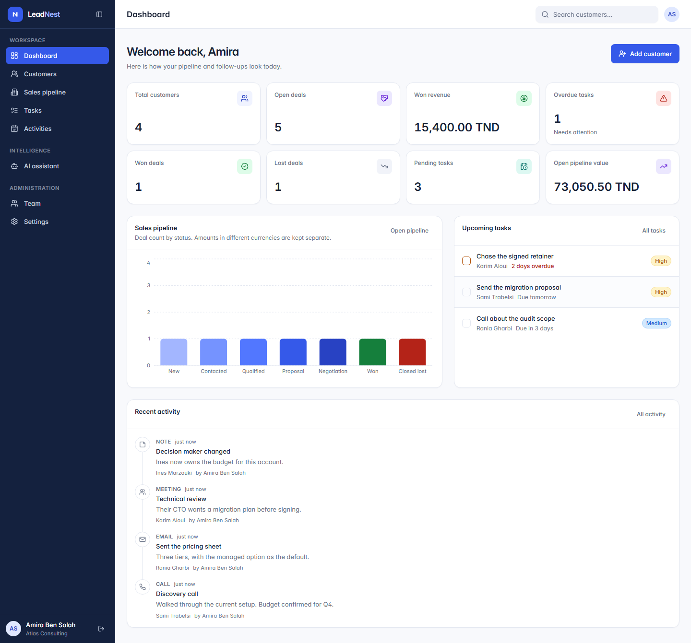

### Customers

| The list, with search, filters and server-side pagination | The record, with its deals and activity |
| :-- | :-- |
| 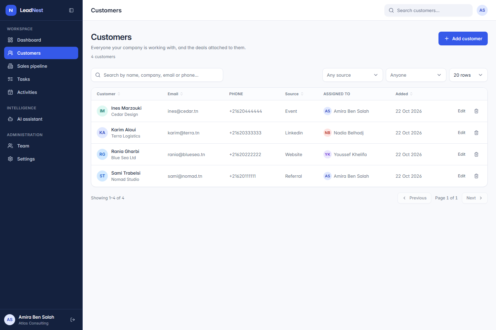 | 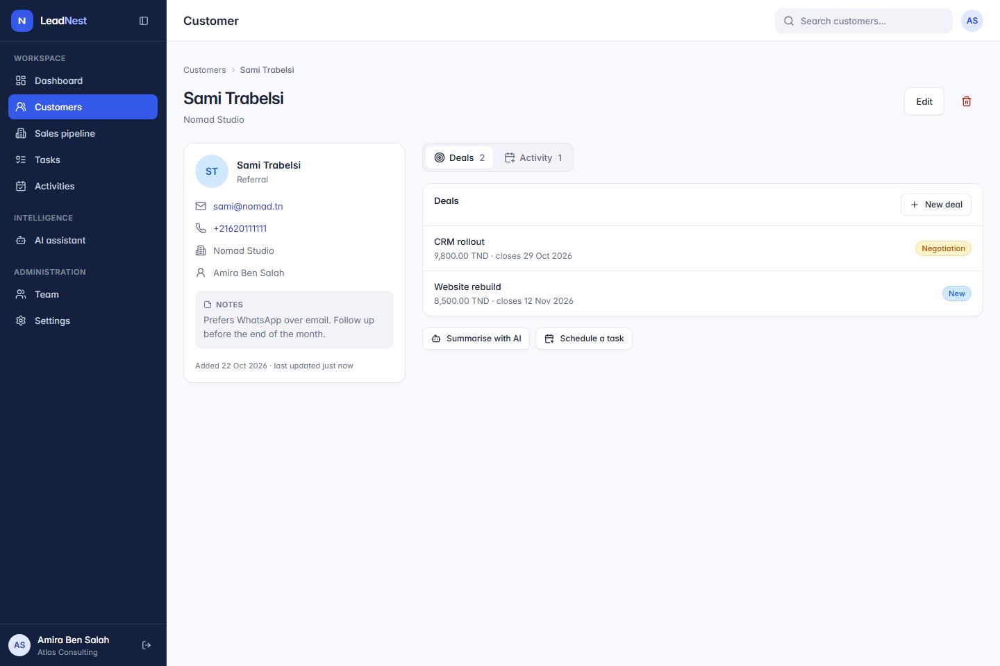 |
| 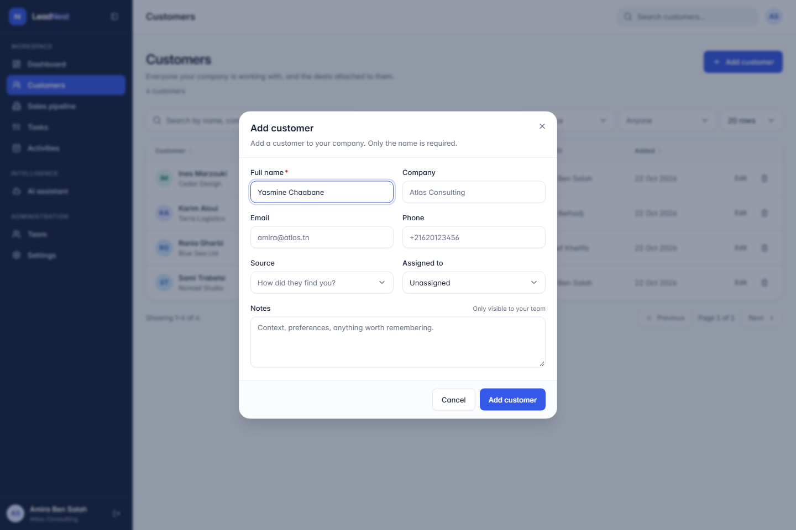 | 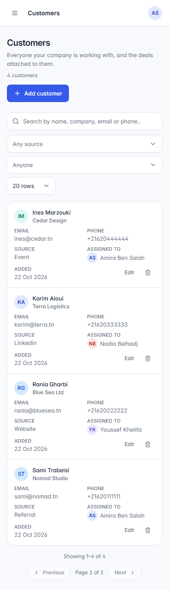 |

### Sales pipeline

| The board, one column per status | A single deal |
| :-- | :-- |
| 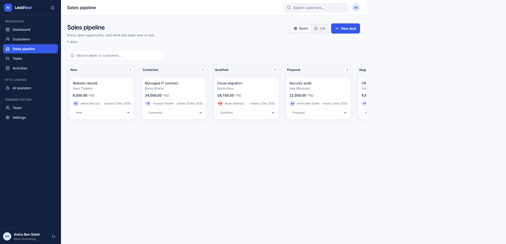 | 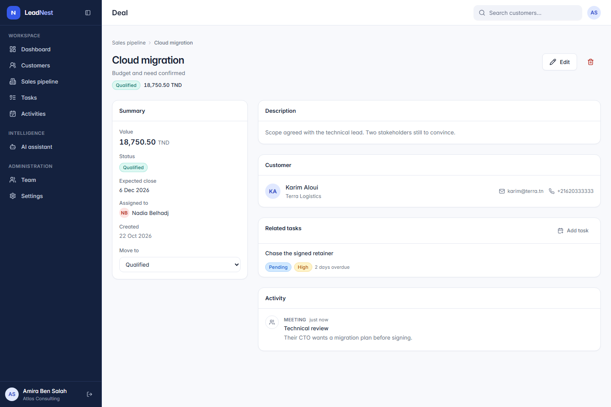 |
| 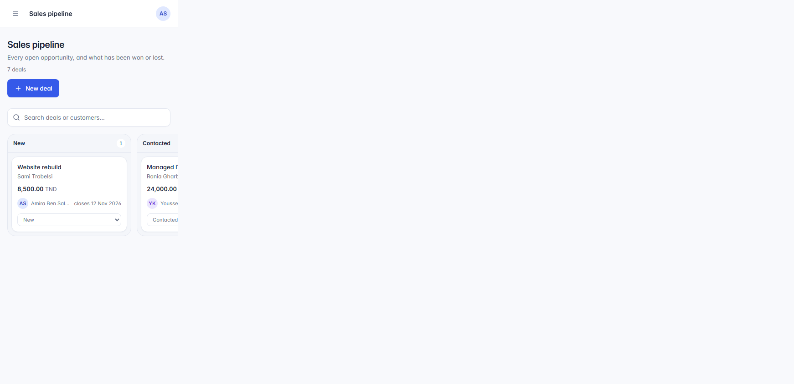 | 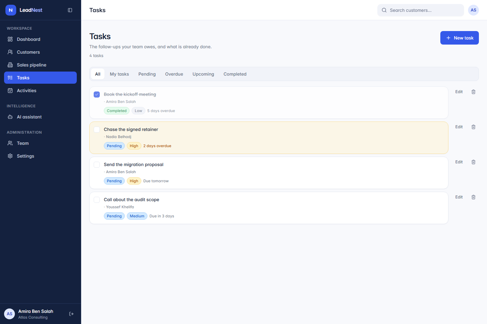 |

### Work and intelligence

| Activities | AI assistant |
| :-- | :-- |
| 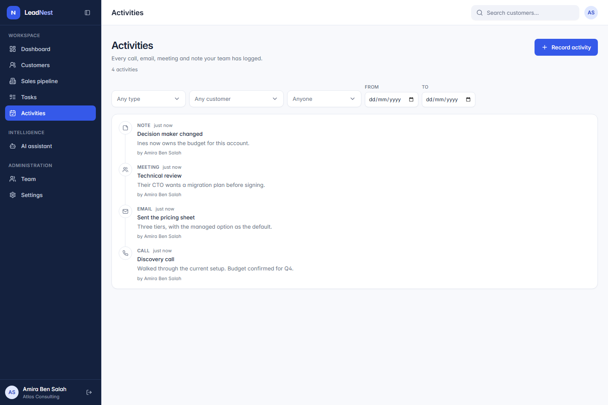 | 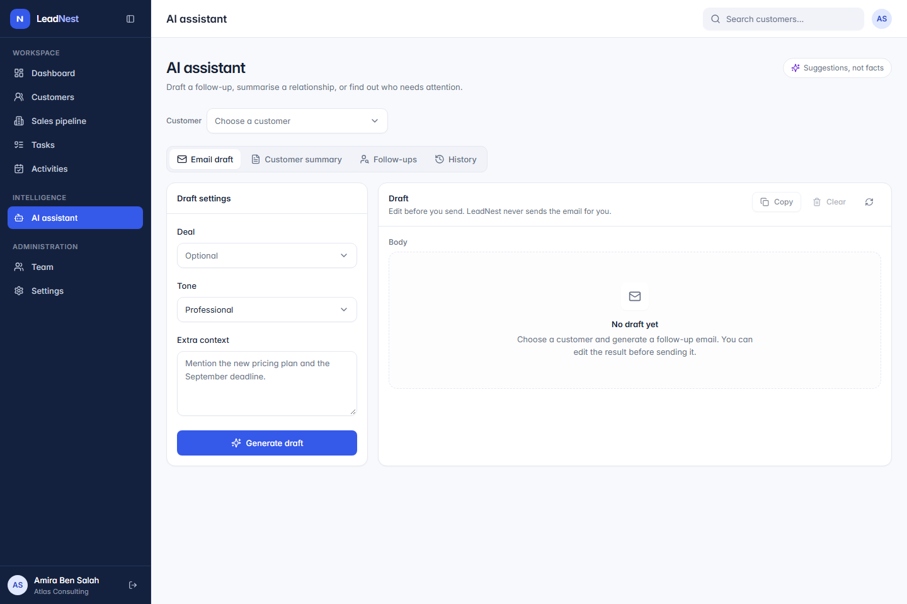 |

| Team | Settings |
| :-- | :-- |
| 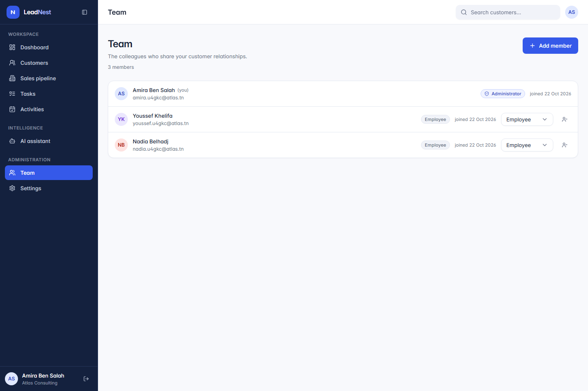 | 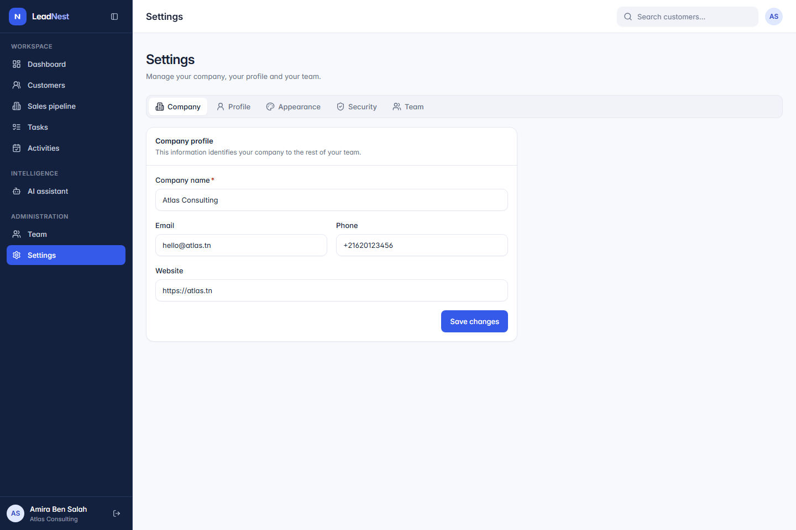 |

### Signing in

| Register a company | Sign in | Mobile dashboard |
| :-- | :-- | :-- |
| 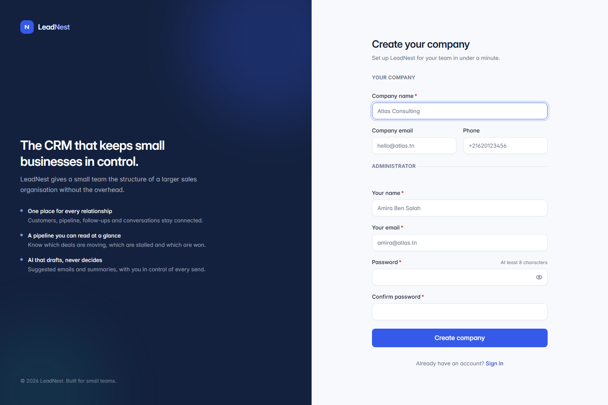 | 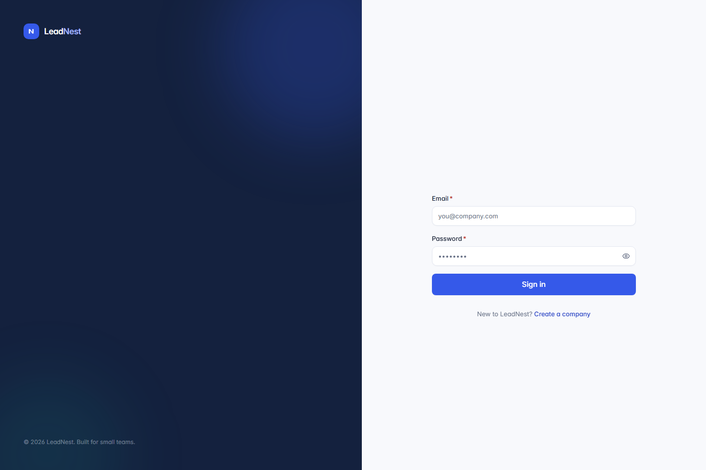 | 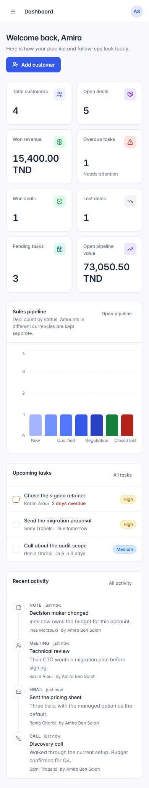 |

The AI assistant is shown without a provider configured, which is how the API
answers when `AI_PROVIDER` is empty: the screen stays usable and every
generation reports that it is unavailable rather than inventing an answer.

---

## Layout

```
leadnest/
├── backend/                 # Go (Gin, PostgreSQL) API
│   ├── cmd/                 # api, migrate, storagecheck
│   ├── internal/            # handlers, repositories, middleware
│   ├── migrations/          # versioned SQL migrations
│   ├── docs/                # generated Swagger documentation
│   ├── scripts/             # test and smoke-test helpers
│   ├── tests/               # integration test suite
│   ├── Dockerfile
│   ├── Dockerfile.test
│   └── Makefile
├── frontend/                # React + TypeScript + Vite client
│   ├── e2e/                 # Playwright end-to-end tests
│   ├── src/                 # application source
│   └── Dockerfile
├── .env.example             # template for the local environment
├── docker-compose.yml       # database, API and web client
├── docker-compose.test.yml  # database and integration test runner
└── .gitignore
```

---

## Quick start with Docker

From this directory:

```bash
cp .env.example .env      # optional: the compose defaults work as-is
docker compose up --build -d
docker compose logs -f api
```

This starts PostgreSQL, applies the migrations, serves the API on
`http://localhost:8080` and the web client on `http://localhost:8081`. The
browser only ever talks to one origin, because the frontend container proxies
`/api` to the backend.

Verify:

```bash
curl http://localhost:8080/health
curl http://localhost:8080/ready
```

Stop the stack with `docker compose down` (add `-v` to drop the database
volume).

---

## Local development

Backend:

```bash
cd backend
go mod download
cp ../.env.example ../.env   # then set the JWT secrets and DB credentials
make migrate-up
make run
```

Frontend:

```bash
cd frontend
npm install
npm run dev
```

The API listens on `SERVER_ADDR` (default `:8080`) and the dev server on
`http://localhost:3000`.

---

## Testing

```bash
# backend unit tests
cd backend && make test

# backend integration tests (needs PostgreSQL)
docker compose -f docker-compose.test.yml up -d db-test
docker compose -f docker-compose.test.yml run --rm tests

# frontend
cd frontend && npm test
```

See the two README files for the full list of commands and for the API
reference.
